## Всем привет！ 👋
Меня зовут Ярослав. 
Да, я QA Engineer, но мне нравится разбирать и решать сложные задачи.

 <!-- Данный ассет был скопирован с «https://github.com/neffrit», за что отдельное ему спасибо! -->

<!-- Курс QA Studio · 9 месяцев практики на реальных продуктах · собственное приложение для тестировщиков

&nbsp;&nbsp; -->

<!--## 📊 Статистика

 -->

<!-- Выбор темы ↑↑: https://github.com/anuraghazra/github-readme-stats/blob/master/themes/README.md --> 
<!-- Настройка отображения ↑↑: https://github.com/anuraghazra/github-readme-stats/ --> 

<!-- -->

<!-- Выбор темы ↑↑: https://github.com/Ashutosh00710/github-readme-activity-graph/blob/main/THEMES.md --> 

 

##  Инструменты

#### Тестирование API и интеграций
<table width="100%">
  <tr align="center">
    <td> Postman</td>
    <td> Rest</td>
    <td> Soap</td>
    <td> Kafka</td>
    <td> Swagger</td>
    <td> Docker</td>
  </tr>
</table>

#### Тестирование Web и мобильных приложений
<table width="100%">
  <tr align="center">
    <td> Figma</td>
    <td> HTTP</td>
    <td> HTML</td>
    <td> JavaScript</td>
    <td> Android Studio</td>
    <td> Charles</td>
  </tr>
</table>

#### Автотесты
<table width="100%">
  <tr align="center">
    <td> Cypress</td>
    <td> Selenium</td>
    <td> PyTest</td>
    <td> GitLab</td>
    <td> GitHub</td>
    <td> VS Code</td>
    <td> Python</td>
  </tr>
</table>

#### Базы данных
<table width="100%">
  <tr align="center">
    <td> Metabase</td>
    <td> MySQL</td>
    <td> PostgreSQL</td>
    <td> DBeaver</td>
    <td> MongoDB</td>
  </tr>
</table>

#### Логи и мониторинг
<table width="100%">
  <tr align="center">
    <td> Kibana</td>
    <td> Sentry</td>
    <td> Grafana</td>
    <td> Jaeger</td>
    <td> Bash</td>
  </tr>
</table>

<!-- Выбор картинок ↑↑: https://github.com/tandpfun/skill-icons --> 

 

## 🪴 Практика и стажировка
<!-- 

 -->

 

## 🎒 Образование
<!-- 
 -->

 
 

## 🤝 Контакт
<!-- 
 -->

<!-- Документация по виджету контактов ↑↑ https://shields.io/badges --> 
